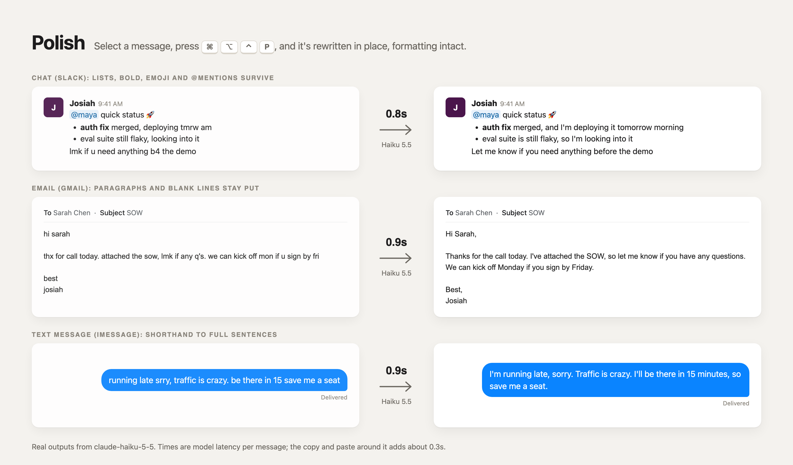

# Polish

Select a message anywhere on your Mac, press **⌘⌥⌃P**, and it's rewritten in place: shorthand becomes full sentences, typos are fixed, and the formatting stays exactly as it was.

## Install

```bash
git clone https://github.com/josiahcoad/polish.git && cd polish && ./install.sh
```

The installer asks for an [Anthropic API key](https://console.anthropic.com/settings/keys) and installs two Quick Actions:

- **⌘⌥⌃P** polishes the selected text.
- **⌘⌥⌃,** opens settings: edit the style prompt, change the shortcut, or replace your API key.

The first time you use it, macOS asks to let the app you're typing in control your computer (System Settings → Privacy & Security → Accessibility). Polish needs this to copy your selection and paste the result.

To update later, run `git pull && ./install.sh`.



## Where to use it

Turn rough messages into polished ones in Slack, Gmail and iMessage, especially when you type fast in shorthand with loose grammar and spelling but want to come across polished.

## How it compares

| | The catch |
|---|---|
| **Polish** | None: keeps formatting, works in any app, takes about a second, and costs under $0.10 a month at 30 messages a day on your own API key |
| Grammarly | $30 a month |
| Pasting into ChatGPT or Claude | Slow and cumbersome: copy, switch apps, prompt, copy back, fix the formatting |
| Wispr Flow commands | Doesn't keep formatting, especially in Slack |
| Gmail "Polish" | Doesn't keep formatting, and only works in Gmail |

## How it works

1. Copies your selection with ⌘C and reads the rich version from the clipboard: Slack's own format, HTML, or plain text.
2. Converts it to light markup, one line per paragraph, so the model sees the formatting but can't break it.
3. Sends it to `claude-haiku-5-5` with your style prompt and fixed formatting rules.
4. Rebuilds the original format, pastes it with ⌘V, then restores your clipboard.

Files live in `~/.config/polish/`:

| File | Purpose |
|---|---|
| `key` | Your API key (only you can read it) |
| `style.txt` | Your style prompt, created the first time you choose **Edit style** |
| `api_url` | Optional: send requests through a proxy or gateway instead of `api.anthropic.com` |
